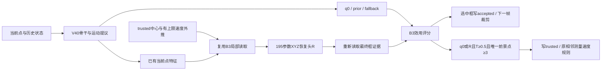

# V41 的运动先验、当前点恢复与可信更新

**截至 2026-11-18，V41 有两项不同的 KITTI Car 对照。**

| 版本与研究问题 | 已有证据 |
|---|---|
| v1 带恢复与可信更新的完整系统，和原始 SeqTrack3D 方法＋本地 KITTI 适配相比表现如何？ | 两组 seed42、scratch60 已完成。固定 test 19–20 的第 60 轮 Success/Precision 为 69.7712/81.9497 对 37.6767/48.2966。该差值支持这次完整配方的比较，各模块贡献仍需同底座对照。[固定结果与比较器](../artifacts/ct_checks/20261117_kitti_final_research_review/REPORT.md) |
| exec v3 在同一 Full 上提高较短车体轴的中心误差权重，能否改善定位？ | 两组均保留 B1、训练侧 MTP、B3/R 与主辅双流。A 等权，B 对主流 q0 的三轴中心损失按归一化的首框长宽高倒数加权。11 月 18 日 18:26:18（北京时间）的日志显示两组均进入第 1 轮，尚无末三轮开发集比较。[正式训练记录](../artifacts/ct_checks/20261118_v41_live_speed_1814/REPORT.md) · [配对判据](CTSEQTRACK_V41_RUN_WORKFLOW.md#q0-车宽与高度定位-ab) |

exec v3 退役了 B1 的 acquisition 头、全云标签和相应训练损失，同时精简主流 GT10 传输与候选几何。v1 的固定分数归属冻结源码 `5c92b1c`。当前版本的整轮墙钟与最终精度由各自的运行记录确定。[研究进展](PROJECT_STATUS.md) · [v3 执行变更](V41_TRAINING_PERF.md)

## 当前结构与贡献边界

V41以SeqTrack3D的点云编码与框序列解码骨架为基础，但B0已改动唯一有效点、masked BN、前景使用、历史条件、局部读取和损失归约，不能简写成“原始SeqTrack只加B1/B3”。当前结构是 **B0观测＋物理时间B1＋训练侧MTP＋独立B3＋双ROI搜索＋R恢复**；旧B2的身份记忆、扩展证据、vote/mode已从v38主线退出，V39的G与跳骨干也不在本版。

研究主张集中于运动预测、当前观测纠偏与可信状态更新的分工：B1预测物理位移并提供可微context，B3分别判断输出位置效用和测量可信资格，R提供当前几何修正。CfC、MTP、FA2或小参数头本身不构成已经验证的独立贡献；当前T也不能称已完成独立校准。B1每次前向从零隐藏态编码最近三历史框的两次转移，不是整轨持续保留隐藏态。详细代码差分见 [相对SeqTrack的审查](../artifacts/ct_checks/20261104_window_seqtrack_review/seqtrack_delta.md)。

## 恢复链

- 唯一新增几何头为零初始化 `Linear(64,3)`。seed局部XYZ残差除以L/W/H归一化，经tanh限制于每轴一个对应尺寸；yaw/尺寸不变。复用当前1024点与骨干特征，无第二次骨干或新增ROI。
- R每帧生成，seed沿用trusted速度外推上限1.5秒，不依赖备用ROI是否触发。局部无真实唯一点则无效；R与传播框重合仍保留测量来源。旧三候选内部去重不变，效用同分顺序q0、R、prior、fallback。
- accepted跟随所有选中候选。仅q0/R可申请trusted，沿用T与三个唯一当前前景点条件；传播不得写trusted。重定位后继续要求相邻合法可信测量才能建立速度，位置跳跃不直接变为速度。
- 候选接口显式携带来源及 `measurement_candidate`。旧q0 quality、B3位置效用、可信T独立；选R时不借用q0 quality。四来源one-hot使B3融合层另增加64个权重，因此**195是恢复头参数数目，不是全模型唯一增加的参数数目**。
- R定位损失为归一化XYZ Smooth L1，权重0.1；seed局部实际读取中至少三个唯一GT目标点且残差可表示才监督。其他候选继续适用的S/P/T/ranking监督。T按有效测量候选归一化，候选框坐标不经B3效用反向牵动B0/B1。

## 长失跟训练

正常主训练仍为四分支4N端点、1/4/4/8与10轮课程。新增独立辅助队列：每轮由seed和epoch确定性选择**完整训练轨迹**，非首帧端点最多N/4；过长且无法放入余量的轨迹跳过，不截断。每条从首帧GT初始化一次，此后仅沿自身预测递推。

这里1/4/4/8是各分支连续递推后重置训练状态的窗口上限；每次前向仍最多三历史帧＋当前帧，状态逐步detach，没有跨8步BPTT。两个4分支的窗口边界错开，并非完全重复；原始SeqTrack也有约4N的候选采样，不能由四分支推断CT独有四倍曝光。已有S/W对照未证明精确配比最优，v36整轨长分支负对照也不支持直接全部拉长。KITTI的8步约0.8秒，与nuScenes约4秒不同；详见 [窗口实验证据](../artifacts/ct_checks/20261104_window_seqtrack_review/window_experiment_evidence.md)。

辅助流B0/B1/decoder使用eval与no_grad，仅恢复头和B3接受梯度，不运行MTP损失。辅助损失为0.25×(原B3损失＋0.1定位损失)，均匀插入主batch，共用一次backward/Adam。主训练的启用模块继续正常训练。两流独立状态、辅助RNG隔离、主路BN不被辅助流更新；Adam成功后分别提交，辅助完整结束才允许epoch可恢复。

N/4约为主4N的6.25%额外端点预算，**不代表耗时增加6.25%**：整轨持续递推、局部重读和候选监督均有成本，实际需测量。长轨本身也不保证难例覆盖。被动审计记录递推深度、trusted/support年龄、IoU<0.1开始至IoU≥0.5结束的失跟段、删失段、失跟后当前采样内GT点≥3的端点及XYZ可监督正例数量。

`workers=4`沿用每个DataLoader的设置；独立辅助流会额外建立自己的4个worker与预取队列。CPU内存和I/O也需纳入服务器成本验收，不能只看GPU峰值。

## KITTI 数据与 v1 固定对照

| 项目 | V41 Full | 原始SeqTrack3D方法＋KITTI适配 |
|---|---|---|
| batch / epoch / seed | 16 / 60 / 42 | 16 / 60 / 42 |
| 初始化 | scratch | scratch |
| LR | 1.5e-4，第 20、40 轮后 ×0.2 | 1e-4，每 20 轮 ×0.1 |
| workers | 4 | 10 |
| 主训练算法 | V40＋上述恢复链与辅助流 | 原网络、loss、teacher、采样、优化器 |
| 对比轮次 | final60及58/59/60均值 | 相同 |

训练0000–0016，开发0017–0018，测试0019–0020。只读清单为Car训练441条/19,522帧，开发18条/1,354帧，测试120条/6,424帧；正式运行仍核对实际逐帧集合。采用两组相同的 `open3dsot_velodyne_v1`：原Velodyne点，Tr逆变换及固定yaw的M²/SeqTrack约定，不混用CT旧rectification/水平化。KITTI为sensor-relative坐标；历史日志中保留的 `*_world` 字段不能解释为全局世界坐标。

CT正常训练GT10宽缓存只作存储优化：历史、主和备用ROI完全包含时使用，保留原始ID/顺序并映射回raw索引，否则读完整原云。exec v3 的主训练 worker 交付窄视图与原帧定位信息，越界时按物理帧回退。详细覆盖按实际需要统计。辅助/开发/测试关闭GT预裁剪。baseline维持其训练宽缓存习惯、评测关闭，并用独立缓存版本避开旧空云占位缓存。

仅0001/000177–000180.bin的已知缺失返回3×0真空云，保留端点和时间；其他缺失、损坏或非有限数据报错。两组评测均用首帧尺寸。CT以原始frame_id×0.1秒计时，baseline保留原时间编码。共同manifest登记几何/划分，42份label/calib SHA写入每次运行身份；逐帧比较核对原scene/track/frame集合。

## 版本隔离与解释边界

V41 由 `main.py` 进入独立宿主 `models/ctseqtrackv41.py`，算法与数据适配分别位于 `models/ct_v41/`、`datasets/kitti_v41.py`。运行清单自动记录实际配置与换行归一化的源码身份。同 run 续训须匹配原源码、训练配置和数据，并完成主辅双流的整轮提交。v1 固定测试使用匹配训练的旧源码，v3 的两组 q0 从头训练。[v1 复现记录](CTSEQTRACK_V41_LAUNCH.md) · [v3 运行流程](CTSEQTRACK_V41_RUN_WORKFLOW.md)

11 月 2 日实施前的源码、逐文件 SHA 和基线部署回执保存在 [实施归档](../artifacts/ct_checks/v41_implementation_20261102-201312/)。

M²-Track的第二阶段几何精修在KITTI Car消融中改善4.20 Success/3.50 Precision，支持“运动后当前几何精修”方向，不能预测本实现收益：[表5](https://arxiv.org/html/2203.01730v1)。ChronoTrack的记忆/监督消融提醒不能只拉长历史：[表4](https://arxiv.org/html/2604.13789v1)。本次借鉴DAM4SAM及运动置信工作的是输出位置与可信更新分离，不新增连续确认、年龄或运动硬门。

已有V40诊断支持恢复链存在漏洞，但两个KITTI系统的结果只能评价整体方案，不能单独归因恢复头/B1。局部无目标、XYZ范围不足、yaw错误、B3错选及T误校准仍可能使恢复失败。需同时检查候选覆盖、选框、连续恢复、错误trusted写入、长失跟长度与运行成本；定位loss下降不等于涨分。

## 研究问题与验证进度

[11月4日逐帧诊断](../artifacts/ct_checks/20261104_kitti_readonly_audit/REPORT.md)显示，主要长轨中常先出现在线B0定位/前景错误，再经accepted历史和裁剪形成持续失跟；不能把ROI无目标当成全部问题的起点。主训练成熟课程仍有41.630%端点从GT历史重置、39.324%直接获得精确GT速度。共同历史扰动保留中心差分速度，而在线只有首框、初始速度无效。完整轨迹辅助中上游eval＋no_grad是当前实现事实，因此不能称B0/B1已经得到整轨在线状态训练；这些证据支持优先核查状态分布差异，尚未独立证明各因素的因果贡献。

搜索先围绕上一 accepted 裁剪，再计算当前 B1。v1 第 9 轮有 1,102/1,336 个预测端点在两个 ROI 中都没有目标点。到第 36 轮，四条开发长轨各接受一次回顾性 GT 历史校正后，首次 IoU < 0.1 推迟 0.9–1.8 秒，最终仍全部失跟。再次失跟时每轨仍采到 33–117 个目标点，所有可用候选的 IoU 均低于 0.1。这一观察给 q0 的中心定位对照提供了动机，GT 历史只用于故障诊断。[第 36 轮原批次回放](../artifacts/ct_checks/20261118_e36_gt_history/REPORT.md)

可信更新的研究问题是：当帧输出相同时，写入的位置或速度如何改变后续搜索与恢复？v1 第 60 轮的单次搜索锚点、测速干预已在 5 个开发切点和 2 条已知测试长轨回放。一例跳过测速后，40 帧后的中心误差从 9.33 m 降至 2.55 m，但更早失跟且随访窗口内未恢复。验证持续接管仍需要更多自然缺测事件，并分别记录采点、选框、可信写入和恢复时长。[配对分叉及数值敏感性](../artifacts/ct_checks/20261118_server_counterfactual/REPORT.md)
