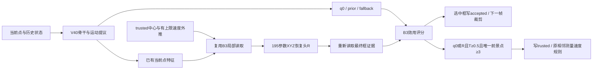

# V41 最小恢复优化与 KITTI Car 两组实验

2026-11-02：按用户确认的第一版方案实施，仅将新 Full 学习率明确为 **1.5e-4，完成20/40轮后乘0.2**。主训练窗口1/4/4/8、10轮课程、B1融合、MTP及骨干保持V40方案。当前完成代码与静态审阅，运行验收待服务器执行，未产生V41精度或性能结论。

## 恢复链

- 唯一新增几何头为零初始化 `Linear(64,3)`。seed局部XYZ残差除以L/W/H归一化，经tanh限制于每轴一个对应尺寸；yaw/尺寸不变。复用当前1024点与骨干特征，无第二次骨干或新增ROI。
- R每帧生成，seed沿用trusted速度外推上限1.5秒，不依赖备用ROI是否触发。局部无真实唯一点则无效；R与传播框重合仍保留测量来源。旧三候选内部去重不变，效用同分顺序q0、R、prior、fallback。
- accepted跟随所有选中候选。仅q0/R可申请trusted，沿用T与三个唯一当前前景点条件；传播不得写trusted。重定位后继续要求相邻合法可信测量才能建立速度，位置跳跃不直接变为速度。
- 候选接口显式携带来源及 `measurement_candidate`。旧q0 quality、B3位置效用、可信T独立；选R时不借用q0 quality。四来源one-hot使B3融合层另增加64个权重，因此**195是恢复头参数数目，不是全模型唯一增加的参数数目**。
- R定位损失为归一化XYZ Smooth L1，权重0.1；seed局部实际读取中至少三个唯一GT目标点且残差可表示才监督。其他候选继续适用的S/P/T/ranking监督。T按有效测量候选归一化，候选框坐标不经B3效用反向牵动B0/B1。

## 长失跟训练

正常主训练仍为四分支4N端点、1/4/4/8与10轮课程。新增独立辅助队列：每轮由seed和epoch确定性选择**完整训练轨迹**，非首帧端点最多N/4；过长且无法放入余量的轨迹跳过，不截断。每条从首帧GT初始化一次，此后仅沿自身预测递推。

辅助流B0/B1/decoder使用eval与no_grad，仅恢复头和B3接受梯度，不运行MTP损失。辅助损失为0.25×(原B3损失＋0.1定位损失)，均匀插入主batch，共用一次backward/Adam。主训练的启用模块继续正常训练。两流独立状态、辅助RNG隔离、主路BN不被辅助流更新；Adam成功后分别提交，辅助完整结束才允许epoch可恢复。

N/4约为主4N的6.25%额外端点预算，**不代表耗时增加6.25%**：整轨持续递推、局部重读和候选监督均有成本，实际需测量。长轨本身也不保证难例覆盖。被动审计记录递推深度、trusted/support年龄、IoU<0.1开始至IoU≥0.5结束的失跟段、删失段、失跟后当前采样内GT点≥3的端点及XYZ可监督正例数量。

`workers=4`沿用每个DataLoader的设置；独立辅助流会额外建立自己的4个worker与预取队列。CPU内存和I/O也需纳入服务器成本验收，不能只看GPU峰值。

## 数据与正式配方

| 项目 | V41 Full | 原始SeqTrack3D方法＋KITTI适配 |
|---|---|---|
| batch / epoch / seed | 16 / 60 / 42 | 16 / 60 / 42 |
| 初始化 | scratch | scratch |
| LR | 1.5e-4；每20轮×0.2 | 1e-4；每20轮×0.1 |
| workers | 4 | 10 |
| 主训练算法 | V40＋上述恢复链与辅助流 | 原网络、loss、teacher、采样、优化器 |
| 对比轮次 | final60及58/59/60均值 | 相同 |

训练0000–0016，开发0017–0018，测试0019–0020。只读清单为Car训练441条/19,522帧，开发18条/1,354帧，测试120条/6,424帧；正式运行仍核对实际逐帧集合。采用两组相同的 `open3dsot_velodyne_v1`：原Velodyne点，Tr逆变换及固定yaw的M²/SeqTrack约定，不混用CT旧rectification/水平化。KITTI为sensor-relative坐标；历史日志中保留的 `*_world` 字段不能解释为全局世界坐标。

CT正常训练GT10宽缓存只作存储优化：历史、主和备用ROI完全包含时使用，保留原始ID/顺序并映射回raw索引，否则读完整原云。原云一直保留，acquisition及审计始终访问raw。辅助/开发/测试关闭GT预裁剪。baseline维持其训练宽缓存习惯、评测关闭，并用独立缓存版本避开旧空云占位缓存。

仅0001/000177–000180.bin的已知缺失返回3×0真空云，保留端点和时间；其他缺失、损坏或非有限数据报错。两组评测均用首帧尺寸。CT以原始frame_id×0.1秒计时，baseline保留原时间编码。共同manifest登记几何/划分，42份label/calib SHA写入每次运行身份；逐帧比较核对原scene/track/frame集合。

## 版本隔离与解释边界

新代码 `models/ct_v41/`、独立host `models/ctseqtrackv41.py`、独立数据适配 `datasets/kitti_v41.py`。新登记仅两组。旧V40源码、YAML、登记和output保持；改动共享入口后，旧checkpoint应使用实施前封存源码，不放宽跨版本恢复检查。

实施前源码快照及逐文件SHA位于 `artifacts/ct_checks/v41_implementation_20261102-201312/`。服务器baseline修改前也逐字节备份，部署回执在该目录的 `seqtrack_baseline/`。本地冻结兄弟baseline未修改。CT服务器源码由用户上传；本次未启动训练、运行模型或安装环境。

M²-Track的第二阶段几何精修在KITTI Car消融中改善4.20 Success/3.50 Precision，支持“运动后当前几何精修”方向，不能预测本实现收益：[表5](https://arxiv.org/html/2203.01730v1)。ChronoTrack的记忆/监督消融提醒不能只拉长历史：[表4](https://arxiv.org/html/2604.13789v1)。本次借鉴DAM4SAM及运动置信工作的是输出位置与可信更新分离，不新增连续确认、年龄或运动硬门。

已有V40诊断支持恢复链存在漏洞，但两个KITTI系统的结果只能评价整体方案，不能单独归因恢复头/B1。局部无目标、XYZ范围不足、yaw错误、B3错选及T误校准仍可能使恢复失败。需同时检查候选覆盖、选框、连续恢复、错误trusted写入、长失跟长度与运行成本；定位loss下降不等于涨分。

运行与验收见 [V41操作页](CTSEQTRACK_V41_LAUNCH.md)。
