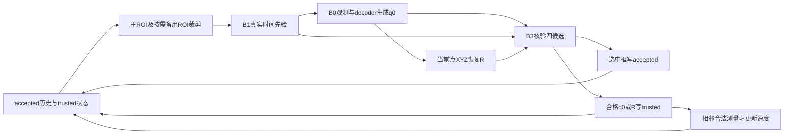

# CT-SeqTrack 当前结构、实验进展与研究方向

文档整理日期：**2026-11-08**。当前实现为 **V41**，对应已审阅运行源码 `5c92b1c`。最新运行证据截至 **2026-11-04 10:46:53（北京时间）**；本页没有重新访问服务器，不能据此断言 11 月 8 日仍在训练、已经结束或已经停止。

本页汇总现行结构与已有证据；实验规则见[实验协议](EXPERIMENT_PROTOCOL.md)，精确机制见[V41设计](CTSEQTRACK_V41_DESIGN.md)，操作见[V41操作页](CTSEQTRACK_V41_LAUNCH.md)。旧日期文档的“当前”“待上传”“待训练”只描述当时状态，不构成重跑旧实验的任务。

## 1. 当前研究定位与真实执行链

项目以 SeqTrack3D 的点云编码、框序列解码骨架为基础，重构观测处理和训练状态，再加入物理时间运动先验、候选核验与恢复。需要验证的核心主张是：**运动先验与当前观测可靠融合，使当前位置输出、可信测量和速度估计各司其职，并在失跟后重新建立持续跟踪。** 这是研究目标，尚不是已完成的效果结论。

当前生产代码为 `models/ct_v41/`、`models/ctseqtrackv41.py` 与 `datasets/kitti_v41.py`，统一由 `main.py` 分派。B2 的身份记忆、扩展证据、vote/mode 已从 v38 主线退出；V41 双 ROI 不等于重启旧 B2。V39 的 G、跳骨干与 GPU raw cache 未移入当前方案；B4 不在当前生产结构中。

图示保留实际顺序：**先围绕上一 accepted 裁剪，再计算 B1**；当前 learned prior 不直接决定主 ROI。训练时 B1 后还会计算 acquisition 标签，之后才运行 B0/decoder，这条 CPU 标签链有执行成本。机制依据见[结构差分](../artifacts/ct_checks/20261104_window_seqtrack_review/seqtrack_delta.md)与[效率审查](../artifacts/ct_checks/v41_speed_audit_20261103/REPORT.md)。

| 组成 | 当前职责 | 必须保留的边界 |
|---|---|---|
| B0 | 三历史帧＋当前帧的点云观测、coarse/fine定位、历史条件与局部真实点读取 | B0已修改点有效性、前景使用、BN/token与loss；不是原SeqTrack原样基线 |
| B1 | 最近三框的两段转移＋真实dt，经CfC生成context、运动学基底上的有界残差及不确定性 | 每次forward重建hidden并处理两转移，不跨整轨保留CfC隐藏态；运动位移监督不等于累计锚点纠偏 |
| MTP | 从B1 context学习h=2/4未来位移，增强训练侧动力学表示 | 只用未来annotation监督，不读未来点云，不在线生成候选或写状态 |
| B3 | 对q0/prior/fallback/R预测S/P位置效用和独立可信T | 上游输入在边界detach；T是训练分数，不能称已经held-out校准 |
| R | 复用当前点与B3局部读取，输出每轴一个L/W/H以内的XYZ修正 | 不修yaw，不新增骨干；修正后重新读取最终框证据；195仅是恢复头参数，B3来源编码另增64权重 |
| 搜索保护 | 上次实际测量不合格才启双ROI；主768＋备用独有256，总1024、原始ID去重回填 | 备用中心与R seed最多外推1.5s；无速度时保持trusted位置，不是长期重检测 |
| 递推状态 | 所有选中框写accepted；仅q0/R且T≥0.5、最终框内唯一预测前景点≥3才可写trusted | 传播不能自证可信；重定位不直接生成速度，还需相邻可信测量与合法innovation |

参数与状态规则依据[V41设计](CTSEQTRACK_V41_DESIGN.md)及[当前实现差分](../artifacts/ct_checks/20261104_window_seqtrack_review/seqtrack_delta.md)。旧 acquisition head 仍通过辅助loss反传共享B1 context，但已不控制在线搜索、配额、选框或提交；删除其训练loss会改变学习目标，不能按完全死代码处理。

## 2. 相对基础方法的贡献候选与训练语义

值得集中论证的设计是：显式时间运动与观测的职责划分，accepted/trusted/速度分离，以及当前几何恢复到持续可信更新的闭环。框序列建模、local/global编码和历史框监督继承自基础方法；CfC、MTP、FlashAttention、参数少与合同检查本身，均不能自动证明学术首创或跟踪收益。当前没有新的文献查新结论。

主训练四分支分别覆盖全部N个非初始化端点，共4N，成熟窗口为1/4/4/8，前10轮课程逐步加长。两个4的窗口边界错开；每次前向仍只看最多三历史帧与当前帧。状态每步detach并提交，**窗口表示状态重置周期，不是历史输入长度，也不是8步BPTT**。

独立辅助流从合法首框开始走完整轨迹，端点≤N/4，与主流共用Adam步数；辅助流B0/B1/decoder使用eval与no_grad，仅B3/R学习，主流启用模块仍正常训练。因此不能说“B0/B1已经接受完整轨迹训练”。辅助端点占主4N最多6.25%，不等于同样比例的耗时或梯度权重。

现有窗口证据没有证明1/4/4/8必要或最优：v34的1/3/3/8与1/4/4/8在不同LR、final/late3下互有优劣；v36长分支整轨方案反而显著弱于八步重置。后者也不能外推为V41最长8必然最优。当前应同时考察重置频率、GT种子质量、无速度启动与物理时间跨度，不能直接全部拉长或全部改成单步。[窗口实验证据](../artifacts/ct_checks/20261104_window_seqtrack_review/window_experiment_evidence.md)

## 3. 已完成实验与最近运行快照

S/P均表示Success/Precision（百分数）；final60固定第60轮，late3固定58/59/60算术均值。late3不是三个独立seed。不同数据集、坐标、配方和版本的分数不能直接用于模块因果归因。

| 版本 | 已确认进度 | 主要结论与来源 |
|---|---|---|
| v37 | 五组scratch60完成 | 强B1 final=53.7133/66.2746，late3=52.8541/65.3082；Full FP32为49.9136/59.5274、50.0715/59.6327，完整链未胜过强B1。[审查](CTSEQTRACK_V37_RESEARCH_AUDIT_20261021.md) |
| v38 | 三组60轮、各71,700更新，正式验收完成 | Full final=52.0230/63.1313、late3=53.7629/65.4792；优于旧Full并过原门，但相对强B1末轮较差、late3略好，>10m帧从103增至235。[结果](CTSEQTRACK_V38_RESULTS_PROFILE_20261026.md) |
| v39 | A/B各完成13轮，第14轮SIGTERM，最新完整checkpoint为第12轮 | 无final60/late3；G候选采用稀少、动态allocator缓存有专项诊断，不能称完整正式实验已失败。[诊断](../artifacts/ct_checks/20261029_v39_deep_diagnosis/REPORT.md) |
| v40 | 四组60轮、各71,700更新，11月2日完成保存结果复算 | B0总体最好；Full有运动子集正信号，但未稳定兑现总体和长尾收益。[结果](../artifacts/ct_checks/20261102_v40_research_audit/results/REPORT.md) |
| v41 KITTI | 11月4日快照：Full完成9轮、进入第10轮；原SeqTrack适配基线60轮完成 | 已开始真实训练，尚无固定测试集最终比较记录；不能沿用“CT未上传”的旧状态。[快照](../artifacts/ct_checks/20261104_kitti_readonly_audit/REPORT.md) |

V40四组固定结果如下，均为nuScenes-mini Car、seed42、相同106条轨迹/2,285帧。来源与核查范围见[V40数据审查](../artifacts/ct_checks/20261102_v40_research_audit/results/REPORT.md)。

| V40 arm | final60 S/P | late3 S/P |
|---|---:|---:|
| B0 | 53.9967 / 66.1466 | 52.0996 / 62.7068 |
| B1 | 51.2352 / 61.7287 | 49.4610 / 58.6823 |
| B1＋MTP | 51.3687 / 61.6904 | 49.4920 / 57.8326 |
| Full | 51.2987 / 61.2593 | 50.5773 / 60.3085 |

只有B0通过原R/C数值门重算；完整官方比较器的配置/采样/几何重建验收未执行，不写成四组已通过全部验收。Full相对B0的运动端点final提高3.099/3.904个百分点，低运动端点下降3.334/5.894个百分点。Full−MTP包含B3、双ROI与后续状态反馈，不能拆成纯B3或纯搜索收益。四组共用FA，也不能识别FA增益。

V41最近运行证据仅到北京时间 **2026-11-04 10:46:53**：

| 项目 | 快照中的状态 | 开发集S/P |
|---|---|---:|
| V41 Full | 完成9/60轮；第10轮2901/4771 batch，step45840 | 第9轮9.4719 / 7.7493 |
| 原始SeqTrack3D方法＋KITTI适配 | 60/60轮、292800步；58/59/60权重已保存 | final60 38.8072 / 50.7109 |
| baseline late3 | 开发集58/59/60均值 | 35.7262 / 46.2808 |
| 固定test19–20 | baseline未见fixed-test目录，Full尚未完成 | 无最终比较记录 |

上述CT与baseline处于不同训练轮次，不是最终胜负比较。dev为0017–0018，其中0017无Car，实际开发分数来自0018的18条轨迹；与test19–20的120条轨迹不能混称。来源：[11月4日KITTI审计](../artifacts/ct_checks/20261104_kitti_readonly_audit/REPORT.md)。

## 4. 当前瓶颈：已观察到什么，尚未证明什么

最新逐帧证据指向：**在线B0定位/前景失配 → accepted历史偏移 → 运动提议与后续裁剪受影响 → 目标离开搜索区 → trusted与R难以重建跟踪。** 部分主导总分的长轨先定位错，后ROI丢目标；11月3日“搜索供给不足”的诊断需要结合这一更早的起点理解，不能只扩大ROI或提高B3排序能力。

| 已有证据 | 对下一步诊断的约束 |
|---|---|
| V41第9轮1336个预测帧中，原云有目标1335、双ROI仍无目标1102、>10m为1055，14次失跟/0次恢复 | 大量失败不是传感器完全无目标；需追溯首次定位分叉，不能只在已空crop里增加恢复loss |
| 成熟主训练仍41.630%端点GT重置，39.324%直接获得精确GT速度 | 共同历史扰动保留了准确差分速度，真实测试只有首框且初始无速度；这是有证据的状态分布缺口，尚未隔离其因果贡献 |
| 第7轮184个好q0中182个预测前景支持不足3点；第9轮107次trusted写入中70次不满足事后可信真值 | 漏写与误写并存，降低T不能修复支持点不足；错误写入不等于所有框IoU都低于0.5 |
| 第9轮辅助流共4770端点：XYZ可监督端点3976；此前已失跟且当前采样又有≥3个GT点的端点101 | 两项是独立统计，未给出交集；正常可见位置修正不等于重捕获训练，完整轨迹辅助不保证恢复难例覆盖 |
| V40双ROI令164帧从主crop无目标变为并集有目标，但这些帧没有好q0或好最终输出 | 覆盖、候选几何、选择和可信接管之间存在断点；覆盖改善不能冒充闭环恢复收益 |

前四项来自[KITTI审计](../artifacts/ct_checks/20261104_kitti_readonly_audit/REPORT.md)，末项来自[V40结果](../artifacts/ct_checks/20261102_v40_research_audit/results/REPORT.md)。这些观察尚未证明BN、某个loss或某道门是唯一根因；同状态单步oracle也不是重新递推的可实现成绩上限。

工程效率是另一条明确问题线。11月3日记录CT前六轮平均4.033小时/轮、baseline约13.172分钟/轮，观察比18.37；两者包含准备、验证、日志与机器争用，不能写成纯模型或推理慢18.37倍。已观察CT显存跨轮稳定，没有持续泄漏证据。重复整云转换/索引/几何、旧acquisition标签、逐字段同步和dense masked骨干有明确开销；FA2只覆盖attention core，不等于整个模型高效。[速度专项](../artifacts/ct_checks/v41_speed_audit_20261103/REPORT.md)

## 5. 下一步优先事项（尚未实施，不构成新增训练授权）

1. **先定位上游首次失配。** 固定权重与当前点，比较预测历史/teacher历史和受控BN统计；观察长轨最初几步的方向、前景召回、q0误差与首次ROI丢失。分开代码事实、相关性和受控实验结论。
2. **对齐主训练状态。** 覆盖无速度首框启动、由预测建立速度、带误差历史及一定长度的真实递推；明确哪些模块接收长状态梯度。保留合理短窗，不因当前失败直接全改整轨，也不把精确1/4/4/8当不可替换创新。
3. **连接运动与搜索，同时处理启动障碍。** 研究先预测再取点及无可靠速度时的有界搜索裕量；区分位置测量资格与运动innovation约束，保留重定位跳跃不能伪造速度的原则。搜索改进不能替代B0自身的在线定位修复。
4. **再核查可信接管与恢复。** 分开前景支持、T、漏写/误写，统计真正失跟后重现的可恢复正例；分别验明候选覆盖、正确选择、可信写入、连续恢复和再次失跟。身份核验与更广搜索属于待评估设计，当前R仍受局部点、XYZ范围和固定yaw限制。
5. **并行做可验证的工程收束。** 复用同事务crop/support/最终框几何与loss统计，减少整云副本和CPU/GPU往返；必须保留R修正后的最终框重读。推理无消费者计算可单独核验；删除acquisition训练目标则是算法变量，需独立评价。
6. **收窄研究主张并保持可解释比较。** 后续若研究模块贡献，需要同底座、同配方的针对性对照；若研究连续时间优势，需要时间机制对照。单seed mini、固定10Hz KITTI、late3或整体Full对baseline都不能独立证明这些主张。本页不自动追加版本、LR、seed或训练预算。

优先顺序综合[11月4日故障诊断](../artifacts/ct_checks/20261104_kitti_readonly_audit/REPORT.md)、[窗口反例](../artifacts/ct_checks/20261104_window_seqtrack_review/window_experiment_evidence.md)及[11月3日工程/研究审查](../artifacts/ct_checks/research_audit_20261103/REPORT.md)。目前改法均需独立验证，不给出预期涨分幅度。

## 6. 现行实验与维护边界

- V41只约定Full与“原始SeqTrack3D方法＋KITTI适配”两组，均scratch、batch16、60epoch、seed42。Full初始LR1.5e-4、完成20/40轮后×0.2；baseline初始1e-4、每20轮×0.1。LR、teacher/采样、辅助曝光与内核精度不同，属于整体系统比较，不是等计算预算或单模块消融。
- KITTI固定train0000–16/dev17–18/test19–20；在dev诊断，固定final60与58/59/60评测，不挑各组best或用test调策略。不能用当前开发分数直接对照其他论文测试分数。
- 两组使用相同`open3dsot_velodyne_v1`与首帧尺寸。KITTI为sensor-relative，运动包含自车影响；日志旧`*_world`命名不能解释成全局世界坐标速度。
- GT可作训练监督与被动审计，在线只能首框初始化。CT正常训练GT10缓存需完整包含预测ROI，否则raw回退；辅助/dev/test禁GT预裁剪。当前静态审阅未发现直接在线GT泄漏，不等于所有动态独立性检查已执行。
- 已取消V41的`41_registration.json`及外部baseline receipt预登记启动门；实际源码和配置在运行时自动记录，源码换行归一化。历史文件保留；同run、同数据、完整主/辅双流epoch恢复仍须保持严格身份，不据此放宽跨版本恢复。
- 本轮只更新文档，未修改算法、正式YAML、运行结果或冻结参考库；未执行模型、环境检查、pytest、compileall或服务器操作。旧run使用对应源码，已有output与artifacts不覆盖。快照不授权重启、停止、恢复或再次scratch。

现行规则与操作的详细来源：[实验协议](EXPERIMENT_PROTOCOL.md)、[工具范围](FORMAL_TOOLING.md)、[V41设计](CTSEQTRACK_V41_DESIGN.md)、[V41操作](CTSEQTRACK_V41_LAUNCH.md)、[项目工作约定](../AGENTS.md)。后续更新本页时，应同时注明文档日期和最新运行证据日期，保留结果口径与未验证边界。
